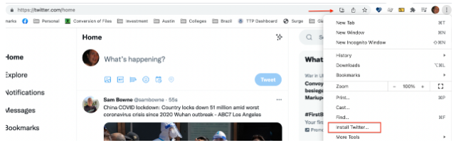

# Homework 4 - Progressive Web Applications (PWAs)

## Objectives

In this assignment, you will demonstrate your understanding of Progressive Web Applications (PWAs) and Service Workers by creating a basic web application that users can install and use offline.

By completing this assignment, you will be able to:

- Explain the main characteristics of Progressive Web Applications (PWAs).
- Create a responsive web page using HTML, CSS, and JavaScript.
- Configure a Web App Manifest to make your application installable.
- Use a Service Worker to cache files and allow your application to work offline.

## Assignment Overview

You will create a simple Progressive Web Application that explains what PWAs are and allows users to change the background of the page. Your application must also be installable through a supported browser and continue working without an internet connection.

> **Before you begin:** Locate the `hw4` folder in the course files you downloaded. This folder contains two background images (light blue and light gold) that you will use for the assignment.

---

## Part 1 - Create the Web Page

**Objective:** Create a responsive web page that introduces PWAs and allows users to change the page background.

### Page Requirements

Create a web page named `index.html` containing:

- A heading of your choice.
- At least two paragraphs explaining the main characteristics of Progressive Web Applications (PWAs).
- A drop-down selection menu with two background options:
  - Light Blue
  - Light Gold

### Background Selection

- The page must initially have a plain white background.
- When the user selects **Light Blue** or **Light Gold**, apply the corresponding background image from the `hw4` folder.
- You may change the background immediately when an option is selected or provide a button that applies the selected background.

### Styling and Responsive Design

- Use an external CSS file to style your page.
- Make sure the page is responsive and displays properly on desktop and mobile devices.
- Use CSS media queries (`@media`) and the Responsive Web Design (RWD) techniques covered in class.
- **Do NOT use CSS frameworks** such as Bootstrap, Semantic UI, or similar frameworks.

---

## Part 2 - Create the Web App Manifest

**Objective:** Configure your application so users can install it on supported devices.

### Requirements

- Create a Web App Manifest file for your application.
- Link the manifest file to your `index.html` page.
- Include the necessary application information, such as:
  - Application name and/or short name
  - Starting URL (`start_url`)
  - Display mode (`display`)
  - Application icons (`icons`)
- Choose an appropriate icon for your application.
- Provide the icon files in the sizes needed for installation. For Chrome, include at least **192 × 192** and **512 × 512** pixel icons.
- Make sure the icon dimensions match the sizes declared in your manifest file.

### Testing Installation

Once your application is uploaded to your web server, open it in Google Chrome and verify that the browser offers an option to install your application.

> The image below shows an example of a PWA installation option in an earlier version of Chrome. The browser interface may look different depending on your browser version and operating system.
>
> *Twitter opened in Chrome browser to show the install icon and the install option in the menu*

> **Tip:** You may need to use an image editor to resize your application icon to the required dimensions. The actual icon dimensions must match what you declare in the manifest file.

---

## Part 3 - Create the Service Worker

**Objective:** Use a Service Worker to make your PWA functional without an internet connection.

### Requirements

- Create a JavaScript file named `service-worker.js`.
- Register the Service Worker from your web page using JavaScript.
- Configure your Service Worker to cache the files required for your application to work offline, including:
  - Your `index.html` page
  - Your external CSS file
  - Your JavaScript file(s), if separate from the HTML
  - Both background images (Light Blue and Light Gold)
  - Other required application resources, such as the manifest and icons
- Make sure your application loads and functions even when the device is offline.
- Verify that users can still switch between the Light Blue and Light Gold background images while offline.

> **Important:** Your application must continue working after the Service Worker has installed and cached the necessary files. You should be able to refresh the page and change its background without an internet connection.

---

## Extra Credit - Local Storage (3 Points)

**Objective:** Use JavaScript Local Storage to save and retrieve a user's name, even after the browser tab or window is closed.

### Page Requirements

On the same `index.html` page, add:

- An input field where the user can enter their name.
- A `<label>` element associated with the input field.
- A paragraph below the input field to display a message containing the stored name.

### JavaScript Requirements

- When the user finishes entering their name, use JavaScript to check Local Storage for a key named `name`.
- If the key does not exist, save the name entered by the user in Local Storage using that key.
- Retrieve the name stored in Local Storage.
- Update the paragraph below the input field to display the retrieved name.
- Make sure the stored name remains available even after the user closes and reopens the browser tab or window.

> **Important:** Local Storage retains saved information across browser sessions unless the stored data is cleared. This differs from Session Storage, which is generally cleared when the associated tab or browsing session ends.

### Demonstration Video

Watch the following video to see how the extra-credit functionality should work. Your application should demonstrate the same Local Storage behavior.

> **Note:** You will receive the additional 3 points only if the feature works as demonstrated and your JavaScript clearly shows that you are using Local Storage.

---

## Testing Your Application

Before submitting your work, complete the following tests to make sure your application works correctly.

### 1. Test the Page and Responsive Design

- Open your application in a desktop or laptop browser.
- Test your page on mobile devices or using the responsive device tools in your browser.
- Verify that the layout adjusts properly to different screen sizes.
- Confirm that both background options work correctly.

### 2. Test PWA Installation

- Access your application using an HTTPS URL.
- Open the application in Google Chrome.
- Verify that the browser recognizes your application and offers an installation option.
- If the installation option does not appear, use Chrome Developer Tools to inspect the manifest and check for errors.

> **Important:** Your application must be served over HTTPS when uploaded to your web server. For local development, browsers also allow Service Workers on `localhost`.

### 3. Test Offline Functionality

- Open your application in Chrome while connected to the internet.
- Allow the Service Worker to install and cache the required files.
- Open Chrome Developer Tools (F12 or right-click and select **Inspect**).
- Select the **Application** panel.
- Under **Service Workers**, verify that your Service Worker is registered.
- Enable the **Offline** option to simulate losing your internet connection.
- Refresh the application.
- Verify that:
  - The page still loads correctly.
  - The text and styling remain visible.
  - You can still switch between the Light Blue and Light Gold backgrounds.
  - The application continues functioning without an internet connection.

> **Tip:** You can also use the **Network** panel in Chrome Developer Tools and select **Offline** to simulate a disconnected device.

### 4. Test the Extra Credit (If Completed)

- Enter a name and verify that it is saved in Local Storage.
- Verify that the paragraph displays the name retrieved from Local Storage.
- Close and reopen the browser tab or window, then verify that the saved name is still available.

---

## Submitting Your Homework

- Complete your `index.html` page and all required supporting files.
- Upload **ALL** files to your web server, including:
  - HTML page
  - CSS file
  - JavaScript files
  - Web App Manifest
  - Service Worker
  - Background images
  - Application icons
- Test the uploaded application using HTTPS in Google Chrome.
- Verify that the PWA offers an installation option and works correctly offline.
- If you completed the extra credit, verify that Local Storage works correctly.
- Log in to Canvas, open **Assignments > Homework 4**, and begin your submission.
- Submit the direct URL to your Homework 4 application (`index.html`).

> **Important:** Submit the URL that opens your Homework 4 application directly, **NOT** your general course home page. Make sure your instructor can access and test your application using the submitted URL.

---

## Grading Criteria (15 Points Total)

See the grading rubric below for the grading breakdown.

### Extra Credit (3 Additional Points)

Successfully implement the Local Storage functionality described above. Your code must demonstrate that you are saving and retrieving the user's name using Local Storage, and the feature must work as shown in the demonstration video.
